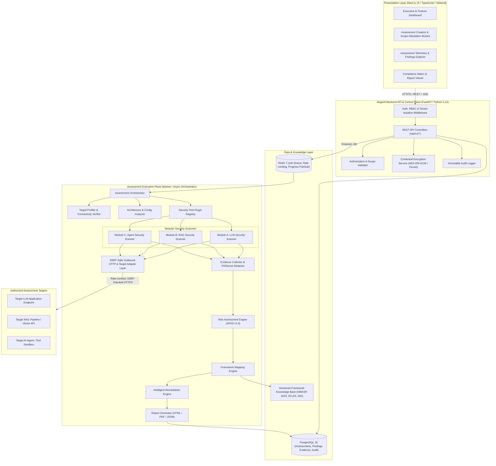

# AegisAI — System & Assessment Engine Architecture

**Document Status:** Phase 1 — Research & Architecture (Baseline v1.0)  
**Architectural Style:** Modular Monolith with Asynchronous Task Execution & Plugin-Based Scanner Registry  

---

## 1. High-Level System Architecture

AegisAI is designed as a **Modular Monolith** with strict domain boundaries. This avoids the distributed-systems tax of premature microservices (network serialization overhead, distributed tracing complexity, schema synchronization drift) while maintaining clean internal interfaces so the scanner workers can scale horizontally when needed.



---

## 2. Technology Stack & Engineering Justification

| Layer | Selected Technology | Engineering Justification |
| :--- | :--- | :--- |
| **Backend Framework** | **Python 3.12 + FastAPI + Pydantic v2** | Python is the lingua franca of AI security research. FastAPI + Pydantic v2 provides high-performance async I/O (critical for concurrent HTTP probing against high-latency LLM endpoints) and strict runtime schema validation. |
| **Database & ORM** | **PostgreSQL 16 + SQLAlchemy 2.0 (Async/Sync) + Alembic** | Relational integrity for multi-tenant assessments, findings, and audit logs, combined with native `JSONB` support for storing structured technical evidence, HTTP request/response traces, and configuration manifests. |
| **Background Execution** | **Redis 7 + Async Worker Pool (with In-Process Asyncio Fallback)** | LLM and RAG security assessments involve dozens of multi-turn probes taking 10s–300s. Offloading execution from the HTTP request thread prevents timeouts and allows real-time progress tracking. |
| **Outbound HTTP & Network Safety** | **HTTPX (Async) + Custom `SafeTargetTransport`** | Custom transport layer that resolves DNS prior to socket connection, validates resolved IPs against RFC 1918 / loopback / link-local / cloud metadata (`169.254.169.254`) blocklists, enforces token-bucket rate limits, and caps response body sizes. |
| **Frontend Framework** | **Next.js (App Router) + React + TypeScript + Tailwind CSS + Lucide Icons** | Strict TypeScript contracts matching backend Pydantic schemas. Tailwind enables a clean, high-density, enterprise cybersecurity interface (inspired by modern cloud security posture platforms). |
| **Testing Suite** | **Pytest + Pytest-Asyncio + HTTPX TestClient + Vitest/Playwright** | Comprehensive unit, API integration, SSRF boundary, and end-to-end assessment pipeline verification. |

---

## 3. Proposed Repository Structure

```text
aegis-ai/
├── docker-compose.yml                  # PostgreSQL, Redis, Backend API, Worker, Frontend
├── .env.example                        # Documented environment configuration template
├── PROJECT_PLAN.md                     # Technical feasibility & MVP scope
├── ARCHITECTURE.md                     # System & assessment engine architecture
├── SECURITY_DESIGN.md                  # Platform security, SSRF, auth, encryption
├── DATABASE_SCHEMA.md                  # Relational & JSONB database design
├── ROADMAP.md                          # Phased engineering execution plan
├── THREAT_MODEL.md                     # STRIDE & AI-specific threat model of AegisAI
│
├── backend/
│   ├── pyproject.toml                  # Dependencies, ruff, mypy, pytest config
│   ├── Dockerfile
│   ├── alembic.ini
│   ├── alembic/                        # Database migrations
│   ├── app/
│   │   ├── main.py                     # FastAPI application factory & lifespan
│   │   ├── core/
│   │   │   ├── config.py               # Pydantic Settings environment config
│   │   │   ├── security.py             # JWT, password hashing (Argon2/Bcrypt), RBAC
│   │   │   ├── crypto.py               # Envelope encryption for target API keys
│   │   │   ├── ssrf_guard.py           # DNS/IP validation & private network blocker
│   │   │   ├── logging.py              # Structured JSON logging with secret redaction
│   │   │   └── exceptions.py           # Domain exception hierarchy
│   │   ├── db/
│   │   │   ├── session.py              # SQLAlchemy engine & session management
│   │   │   └── base.py                 # Declarative base & common mixins
│   │   ├── models/                     # SQLAlchemy ORM models
│   │   │   ├── user.py                 # Organization, User, Role
│   │   │   ├── target.py               # TargetProfile, ScopeAuthorization
│   │   │   ├── assessment.py           # Assessment, AssessmentRunLog
│   │   │   ├── finding.py              # TestExecutionResult, Finding, TechnicalEvidence
│   │   │   ├── framework.py            # SecurityFramework, FrameworkControl, FindingMapping
│   │   │   └── audit.py                # AuditLog
│   │   ├── schemas/                    # Pydantic v2 request/response contracts
│   │   ├── api/
│   │   │   ├── deps.py                 # Auth, tenant scoping, DB dependencies
│   │   │   └── v1/
│   │   │       ├── auth.py
│   │   │       ├── targets.py
│   │   │       ├── assessments.py
│   │   │       ├── findings.py
│   │   │       ├── frameworks.py
│   │   │       ├── dashboard.py
│   │   │       └── reports.py
│   │   ├── engine/                     # CORE ASSESSMENT ENGINE
│   │   │   ├── contracts.py            # Standardized BaseSecurityTest, TestContext, NormalizedTestResult
│   │   │   ├── registry.py             # Plugin discovery & SecurityTestRegistry
│   │   │   ├── orchestrator.py         # AssessmentOrchestrator pipeline
│   │   │   ├── profiler.py             # TargetProfiler (latency, auth check, capability detection)
│   │   │   ├── config_analyzer.py      # Architecture & Configuration Manifest Analyzer
│   │   │   ├── adapters/               # Target communication adapters
│   │   │   │   ├── base.py             # TargetAdapter interface
│   │   │   │   ├── openai_compat.py    # OpenAI-compatible Chat/Completions adapter
│   │   │   │   ├── generic_rest.py     # Configurable JSONpath REST endpoint adapter
│   │   │   │   ├── rag_adapter.py      # RAG query + citation/chunk telemetry adapter
│   │   │   │   └── simulator.py        # Built-in deterministic target simulator for testing
│   │   │   ├── evaluators/             # Hybrid Detection Logic
│   │   │   │   ├── deterministic.py    # Canary matcher, regex/AST sink detector, similarity
│   │   │   │   └── semantic_judge.py   # Constrained analytical evaluator
│   │   │   ├── scanners/
│   │   │   │   ├── common.py           # Shared multi-probe outcome consolidation helper
│   │   │   │   ├── llm/                # Module A: LLM Security Tests (6 suites)
│   │   │   │   ├── rag/                # Module B: RAG Security Tests (4 suites)
│   │   │   │   └── agent/              # Module C: AI Agent Security Tests (3 suites)
│   │   │   ├── evidence.py             # EvidenceCollector & PII/Credential Sanitizer
│   │   │   ├── risk_engine.py          # AVSS v1.0 Risk Assessment Engine
│   │   │   ├── framework_mapper.py     # Authoritative Framework Mapping Engine
│   │   │   ├── remediation_engine.py   # 8-part Structured Remediation Generator
│   │   │   └── report_generator.py     # Executive & Technical HTML/JSON/PDF Report Builder
│   │   └── knowledge_base/             # Versioned Authoritative Framework Data
│   │       ├── owasp_llm_2026.json
│   │       ├── owasp_agentic_2026.json
│   │       ├── owasp_aisvs_v1.json
│   │       ├── nist_ai_rmf_600_1.json
│   │       ├── mitre_atlas.json
│   │       ├── iso_42001_23894.json
│   │       └── remediation_playbooks.json
│   └── tests/                          # Pytest suite (unit, engine, security, API)
│
└── frontend/
    ├── package.json
    ├── tsconfig.json
    ├── next.config.ts
    ├── tailwind.config.ts
    └── src/
        ├── app/                        # Next.js App Router pages
        │   ├── layout.tsx
        │   ├── page.tsx                # Main Security Posture Dashboard
        │   ├── login/page.tsx
        │   ├── assessments/
        │   │   ├── page.tsx            # Assessments List
        │   │   ├── new/page.tsx        # Multi-step Assessment & Scope Wizard
        │   │   └── [id]/
        │   │       ├── page.tsx        # Assessment Results, Risk Breakdown, Live Progress
        │   │       └── findings/[findingId]/page.tsx # Dedicated Vulnerability Detail View
        │   ├── frameworks/page.tsx     # Interactive Security Framework Knowledge Base
        │   └── reports/[id]/page.tsx   # Printable / Downloadable Executive & Technical Report
        ├── components/                 # Reusable enterprise UI components
        ├── lib/                        # Typed API client, formatters, risk badge helpers
        └── types/                      # Strict TypeScript interfaces mirroring backend
```

---

## 4. Assessment Engine Architecture & Standardized Interfaces

### 4.1 Assessment Pipeline State Machine

Every assessment progresses through a strictly tracked lifecycle:

1. **`DRAFT` / `AWAITING_AUTHORIZATION`**: Target and modules selected; awaiting explicit scope attestation signature (`authorized_by_user_id`, `scope_attestation_hash`, `allowed_hosts`).
2. **`QUEUED`**: Authorization verified; job dispatched to the execution runner.
3. **`PROFILING`**: `TargetProfiler` validates DNS/SSRF safety, checks endpoint reachability, verifies authentication headers, measures baseline latency, and identifies response structure (e.g., whether retrieval citations or `tool_calls` are exposed).
4. **`ANALYZING_ARCHITECTURE`**: `ConfigurationAnalyzer` inspects provided architecture metadata (system prompt template, model parameters, RAG config, tool schemas).
5. **`EXECUTING_TESTS`**: `AssessmentOrchestrator` queries `SecurityTestRegistry` for tests matching the selected modules and target capabilities, executing probes via the rate-limited `TargetAdapter`.
6. **`EVALUATING_AND_ENRICHING`**:
   - `EvidenceCollector` redacts sensitive credentials/PII from captured request/response traces.
   - `RiskAssessmentEngine` calculates the AVSS v1.0 score and severity (`CRITICAL`, `HIGH`, `MEDIUM`, `LOW`, `INFORMATIONAL`) with an explicit human-readable rationale.
   - `FrameworkMappingEngine` links confirmed (`FAIL`) and review-required (`NEEDS_REVIEW`) results to authoritative controls (`DIRECT` vs. `CONCEPTUAL` relationship).
   - `RemediationEngine` constructs the 8-part technical remediation guide.
7. **`COMPLETED` / `PARTIAL_ERROR` / `FAILED` / `ABORTED`**: Final posture score computed and audit trail sealed.

### 4.2 Standardized Security Test Plugin Contract

To ensure new security tests can be added without modifying the orchestrator, every test plugin inherits from `BaseSecurityTest` and returns a strongly typed `NormalizedTestResult`:

```python
from enum import StrEnum
from datetime import datetime
from pydantic import BaseModel, Field

class ExecutionStatus(StrEnum):
    PASS = "PASS"                       # Test executed; target demonstrated expected secure behavior
    FAIL = "FAIL"                       # Test executed; deterministic evidence of vulnerability confirmed
    ERROR = "ERROR"                     # Network timeout, HTTP 502, or target unreachable (NOT a pass!)
    NOT_APPLICABLE = "NOT_APPLICABLE"   # Target architecture does not include this component
    NEEDS_REVIEW = "NEEDS_REVIEW"       # Ambiguous behavioral indicator; requires human analyst review

class VulnerabilityStatus(StrEnum):
    VULNERABLE = "VULNERABLE"
    SECURE = "SECURE"
    UNDETERMINED = "UNDETERMINED"
    POTENTIALLY_VULNERABLE = "POTENTIALLY_VULNERABLE"

class SeverityLevel(StrEnum):
    CRITICAL = "CRITICAL"
    HIGH = "HIGH"
    MEDIUM = "MEDIUM"
    LOW = "LOW"
    INFORMATIONAL = "INFORMATIONAL"

class ConfidenceLevel(StrEnum):
    HIGH = "HIGH"       # Deterministic canary/structural proof (e.g., nonce leaked, XSS tag unescaped)
    MEDIUM = "MEDIUM"   # Strong behavioral pattern across multiple probes
    LOW = "LOW"         # Heuristic indicator only; flagged as NEEDS_REVIEW

class TechnicalEvidenceItem(BaseModel):
    probe_index: int
    probe_name: str
    request_payload_redacted: dict | str
    response_body_redacted: dict | str
    http_status_code: int | None
    latency_ms: float
    detector_type: str                  # e.g., "CANARY_TOKEN_MATCH", "SINK_AST_DETECTOR", "CONFIG_RULE"
    matched_indicators: list[str]
    target_component: str               # e.g., "LLM_SYSTEM_PROMPT_BOUNDARY", "RAG_METADATA_FILTER"

class NormalizedTestResult(BaseModel):
    test_id: str                        # e.g., "LLM-PI-001"
    assessment_id: str
    target_component: str
    test_category: str                  # e.g., "Direct Prompt Injection"
    module: str                         # "LLM" | "RAG" | "AGENT" | "CONFIG"
    execution_status: ExecutionStatus
    vulnerability_status: VulnerabilityStatus
    severity: SeverityLevel
    confidence: ConfidenceLevel
    risk_score: float = Field(ge=0.0, le=10.0)
    risk_rationale: str
    technical_evidence: list[TechnicalEvidenceItem]
    framework_references: list[dict]
    recommended_remediation: dict
    execution_timestamp: datetime
```

### 4.3 Critical Separation: `ERROR` vs. `PASS` vs. `FAIL`
A core flaw in naive scanners is treating an HTTP 429/500 or connection timeout as "target blocked the attack (`PASS`)". In AegisAI:
- If the target returns an HTTP 5xx, network timeout, or malformed JSON envelope, the probe is recorded as `ExecutionStatus.ERROR` with `VulnerabilityStatus.UNDETERMINED`.
- If a WAF or AI Guardrail explicitly returns a documented HTTP 400/403 guardrail block response (verified against the baseline profile), it is recorded as `ExecutionStatus.PASS` with evidence citing `GUARDRAIL_INTERCEPTION`.

---

## 5. Transparent Risk Assessment Methodology (AVSS v1.0)

Traditional CVSS v3.1/v4.0 struggles with stochastic AI vulnerabilities (where an attack may succeed 3 out of 5 times or depend on downstream output sinks). AegisAI implements **AVSS v1.0 (AI Vulnerability Scoring System)**, a transparent, deterministic formula stored alongside every finding:

$$\text{Raw Score} = \text{min}\left(10.0, \; \left(0.40 \times I_{\text{impact}} + 0.30 \times E_{\text{exploitability}} + 0.20 \times B_{\text{blast\_radius}} + 0.10 \times X_{\text{exposure}}\right) \times C_{\text{compensating}}\right)$$

Where:
- **$I_{\text{impact}}$ (0–10):** Confidentiality, Integrity, and Agency impact (e.g., arbitrary tool execution = 10.0; cross-tenant RAG document leak = 9.0; system prompt disclosure = 5.5).
- **$E_{\text{exploitability}}$ (0–10):** Ease and determinism of exploitation (e.g., single-turn direct injection = 9.0; complex indirect RAG injection requiring ingestion privileges = 6.0).
- **$B_{\text{blast\_radius}}$ (0–10):** Single user session (3.0) vs. cross-tenant / persistent memory poisoning (9.5) vs. external system mutation (10.0).
- **$X_{\text{exposure}}$ (0–10):** Unauthenticated public endpoint (10.0) vs. authenticated customer portal (7.0) vs. internal employee tool (4.0).
- **$C_{\text{compensating}}$ (0.5–1.0):** Multiplier reflecting verified compensating controls (e.g., strict HITL approval gate reduces score by $0.7\times$).

**Severity Mapping:**
- **Critical:** `9.0 – 10.0`
- **High:** `7.0 – 8.9`
- **Medium:** `4.0 – 6.9`
- **Low:** `1.0 – 3.9`
- **Informational:** `0.0 – 0.9`

Every finding stores the exact vector string (e.g., `AVSS:1.0/I:9.0/E:8.5/B:9.0/X:7.0/C:1.0/CONF:HIGH`) and a plain-English paragraph explaining why that severity was assigned.
