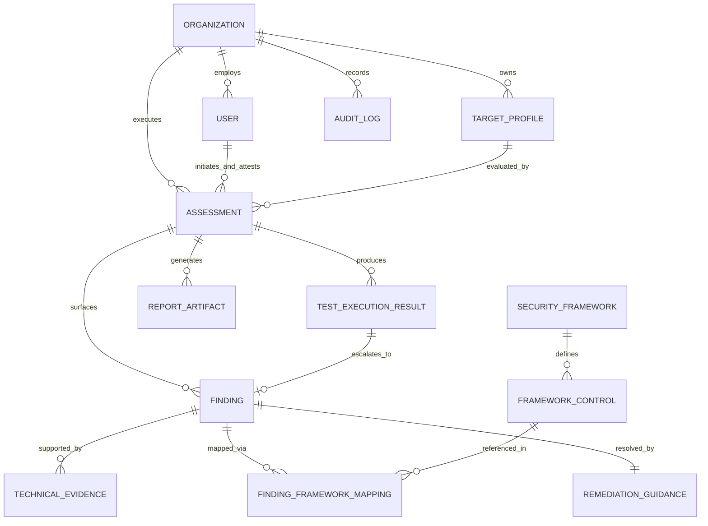

# AegisAI — Database Schema & Knowledge Base Design

**Document Status:** Phase 1 — Research & Architecture (Baseline v1.0)  
**Database Engine:** PostgreSQL 16 (with SQLAlchemy 2.0 ORM & Alembic Migrations)  

---

## 1. Entity-Relationship Diagram (ERD)

---

## 2. Core Relational Tables

### 2.1 Multi-Tenancy, Identity & Audit

#### `organizations`
| Column | Type | Constraints | Description |
| :--- | :--- | :--- | :--- |
| `id` | `UUID` | `PK` | Unique organization identifier |
| `name` | `VARCHAR(160)` | `NOT NULL` | Organization display name |
| `slug` | `VARCHAR(80)` | `UNIQUE, NOT NULL` | URL-safe tenant slug |
| `max_rps_limit` | `FLOAT` | `DEFAULT 5.0` | Tenant-wide outbound probe rate ceiling |
| `created_at` | `TIMESTAMPTZ` | `NOT NULL` | Record creation timestamp |

#### `users`
| Column | Type | Constraints | Description |
| :--- | :--- | :--- | :--- |
| `id` | `UUID` | `PK` | Unique user identifier |
| `organization_id` | `UUID` | `FK(organizations.id), INDEX` | Tenant isolation boundary |
| `email` | `VARCHAR(255)` | `UNIQUE, NOT NULL, INDEX` | User login email |
| `full_name` | `VARCHAR(160)` | `NOT NULL` | Full name for audit & scope attestation |
| `password_hash` | `VARCHAR(255)` | `NOT NULL` | Argon2id / Bcrypt password hash |
| `role` | `VARCHAR(40)` | `NOT NULL` | `ORG_ADMIN`, `SECURITY_ENGINEER`, `VIEWER` |
| `is_active` | `BOOLEAN` | `DEFAULT TRUE` | Account status |
| `created_at` | `TIMESTAMPTZ` | `NOT NULL` | Creation timestamp |

#### `audit_logs`
| Column | Type | Constraints | Description |
| :--- | :--- | :--- | :--- |
| `id` | `UUID` | `PK` | Immutable audit record ID |
| `organization_id` | `UUID` | `FK(organizations.id), INDEX` | Tenant identifier |
| `user_id` | `UUID` | `FK(users.id), NULLABLE` | Actor user ID |
| `action` | `VARCHAR(100)` | `NOT NULL, INDEX` | e.g., `ASSESSMENT_SCOPE_ATTESTED`, `SCAN_STARTED` |
| `resource_type` | `VARCHAR(60)` | `NOT NULL` | `TARGET_PROFILE`, `ASSESSMENT`, `REPORT` |
| `resource_id` | `VARCHAR(64)` | `NOT NULL` | Target resource UUID |
| `details_json` | `JSONB` | `NOT NULL` | Redacted context (scope hash, allowed hosts, IP) |
| `created_at` | `TIMESTAMPTZ` | `NOT NULL, INDEX` | Event timestamp |

---

### 2.2 Target Integration & Scope Configuration

#### `target_profiles`
| Column | Type | Constraints | Description |
| :--- | :--- | :--- | :--- |
| `id` | `UUID` | `PK` | Unique target profile ID |
| `organization_id` | `UUID` | `FK(organizations.id), INDEX` | Tenant owner |
| `name` | `VARCHAR(160)` | `NOT NULL` | Human-readable target name |
| `architecture_type` | `VARCHAR(40)` | `NOT NULL` | `LLM_APP`, `RAG_PIPELINE`, `AI_AGENT`, `HYBRID` |
| `integration_mode` | `VARCHAR(40)` | `NOT NULL` | `BLACK_BOX_REST`, `OPENAI_COMPAT`, `ASSISTED_HARNESS`, `CONFIG_ONLY`, `SIMULATOR` |
| `endpoint_url` | `VARCHAR(512)` | `NOT NULL` | Primary target endpoint URL |
| `allowed_hosts` | `JSONB` | `NOT NULL` | Explicit list of allowed hostnames for SSRF/scope guard |
| `auth_type` | `VARCHAR(40)` | `NOT NULL` | `NONE`, `BEARER_TOKEN`, `API_KEY_HEADER`, `DUAL_TENANT_BEARER` |
| `encrypted_credentials` | `TEXT` | `NULLABLE` | AES-256-GCM / Fernet encrypted JSON of secrets |
| `credential_preview` | `VARCHAR(64)` | `NULLABLE` | Masked preview (e.g., `sk-proj-...8f2a`) |
| `request_template` | `JSONB` | `NOT NULL` | Adapter config (prompt field path, response JSONPath, headers) |
| `architecture_manifest` | `JSONB` | `NOT NULL` | Declared system prompt metadata, RAG vector config, Agent tool schemas, HITL flags |
| `rag_harness_config` | `JSONB` | `NULLABLE` | Canary document tokens, Tenant A vs Tenant B context metadata |
| `agent_harness_config` | `JSONB` | `NULLABLE` | Registered tool definitions, dry-run flags, canary webhook IDs |
| `rate_limit_rps` | `FLOAT` | `DEFAULT 2.0` | Max requests per second to this target |
| `timeout_seconds` | `INTEGER` | `DEFAULT 15` | Per-request timeout |
| `created_at` | `TIMESTAMPTZ` | `NOT NULL` | Creation timestamp |

---

### 2.3 Assessments, Normalized Test Results & Findings

#### `assessments`
| Column | Type | Constraints | Description |
| :--- | :--- | :--- | :--- |
| `id` | `UUID` | `PK` | Unique assessment ID |
| `organization_id` | `UUID` | `FK(organizations.id), INDEX` | Tenant owner |
| `target_profile_id` | `UUID` | `FK(target_profiles.id), INDEX` | Target under assessment |
| `initiated_by_user_id` | `UUID` | `FK(users.id)` | User who authorized and launched the scan |
| `name` | `VARCHAR(200)` | `NOT NULL` | Assessment title |
| `selected_modules` | `JSONB` | `NOT NULL` | e.g., `["LLM", "RAG", "AGENT", "CONFIG"]` |
| `status` | `VARCHAR(40)` | `NOT NULL, INDEX` | `QUEUED`, `PROFILING`, `RUNNING`, `EVALUATING`, `COMPLETED`, `FAILED` |
| `scope_attestation` | `JSONB` | `NOT NULL` | Signed authorization statement, timestamp, SHA-256 scope digest |
| `target_profile_snapshot` | `JSONB` | `NOT NULL` | Immutable snapshot of non-secret target config at run time |
| `progress_pct` | `INTEGER` | `DEFAULT 0` | `0` to `100` completion percentage |
| `total_tests_planned` | `INTEGER` | `DEFAULT 0` | Total tests scheduled |
| `tests_completed` | `INTEGER` | `DEFAULT 0` | Tests finished |
| `overall_risk_score` | `FLOAT` | `DEFAULT 0.0` | Aggregate posture risk score (`0.0` – `10.0`) |
| `posture_grade` | `VARCHAR(16)` | `NULLABLE` | `A`, `B`, `C`, `D`, `F` security posture grade |
| `summary_metrics` | `JSONB` | `NOT NULL` | Counts by severity (`CRITICAL`, `HIGH`, `MEDIUM`, `LOW`, `INFO`) & status (`PASS`, `FAIL`, `ERROR`, `NEEDS_REVIEW`) |
| `started_at` | `TIMESTAMPTZ` | `NULLABLE` | Execution start timestamp |
| `completed_at` | `TIMESTAMPTZ` | `NULLABLE` | Execution finish timestamp |
| `created_at` | `TIMESTAMPTZ` | `NOT NULL` | Creation timestamp |

#### `test_execution_results`
Stores the normalized outcome of **every** executed test (including `PASS`, `ERROR`, `NOT_APPLICABLE`, `NEEDS_REVIEW`, and `FAIL`), ensuring complete auditability of what was tested.

| Column | Type | Constraints | Description |
| :--- | :--- | :--- | :--- |
| `id` | `UUID` | `PK` | Result record ID |
| `assessment_id` | `UUID` | `FK(assessments.id), INDEX` | Parent assessment |
| `test_id` | `VARCHAR(40)` | `NOT NULL, INDEX` | Standardized Test ID (e.g., `LLM-PI-001`, `RAG-AUTH-001`) |
| `module` | `VARCHAR(30)` | `NOT NULL` | `LLM`, `RAG`, `AGENT`, `CONFIG` |
| `test_title` | `VARCHAR(200)` | `NOT NULL` | Human-readable test name |
| `test_category` | `VARCHAR(100)` | `NOT NULL` | Vulnerability category |
| `target_component` | `VARCHAR(100)` | `NOT NULL` | Component evaluated (e.g., `RAG_METADATA_FILTER`) |
| `execution_status` | `VARCHAR(30)` | `NOT NULL, INDEX` | `PASS`, `FAIL`, `ERROR`, `NOT_APPLICABLE`, `NEEDS_REVIEW` |
| `vulnerability_status` | `VARCHAR(40)` | `NOT NULL` | `SECURE`, `VULNERABLE`, `POTENTIALLY_VULNERABLE`, `UNDETERMINED` |
| ` probes_sent` | `INTEGER` | `DEFAULT 0` | Number of probes transmitted |
| `execution_duration_ms` | `FLOAT` | `DEFAULT 0.0` | Duration of test execution |
| `execution_log` | `JSONB` | `NOT NULL` | Diagnostic notes or error trace if `ERROR` |
| `executed_at` | `TIMESTAMPTZ` | `NOT NULL` | Execution timestamp |

#### `findings`
Created for every `FAIL` (Confirmed Vulnerability) or `NEEDS_REVIEW` (Suspected Vulnerability requiring manual verification).

| Column | Type | Constraints | Description |
| :--- | :--- | :--- | :--- |
| `id` | `UUID` | `PK` | Finding identifier |
| `organization_id` | `UUID` | `FK(organizations.id), INDEX` | Tenant owner |
| `assessment_id` | `UUID` | `FK(assessments.id), INDEX` | Parent assessment |
| `test_result_id` | `UUID` | `FK(test_execution_results.id)` | Source test execution |
| `test_id` | `VARCHAR(40)` | `NOT NULL` | e.g., `RAG-AUTH-001` |
| `title` | `VARCHAR(240)` | `NOT NULL` | Specific finding title |
| `module` | `VARCHAR(30)` | `NOT NULL` | `LLM`, `RAG`, `AGENT`, `CONFIG` |
| `category` | `VARCHAR(100)` | `NOT NULL` | Vulnerability category |
| `affected_component` | `VARCHAR(120)` | `NOT NULL` | Pinpointed architectural stage (e.g., `Vector Similarity Search / Missing Tenant Filter`) |
| `severity` | `VARCHAR(20)` | `NOT NULL, INDEX` | `CRITICAL`, `HIGH`, `MEDIUM`, `LOW`, `INFORMATIONAL` |
| `confidence` | `VARCHAR(20)` | `NOT NULL` | `HIGH`, `MEDIUM`, `LOW` |
| `is_confirmed` | `BOOLEAN` | `NOT NULL` | `TRUE` for `FAIL`, `FALSE` for `NEEDS_REVIEW` |
| `avss_score` | `FLOAT` | `NOT NULL` | Numeric score (`0.0` – `10.0`) |
| `avss_vector` | `VARCHAR(140)` | `NOT NULL` | Vector breakdown (`AVSS:1.0/I:9.0/E:8.5/...`) |
| `severity_rationale` | `TEXT` | `NOT NULL` | Transparent explanation of how severity was derived |
| `description` | `TEXT` | `NOT NULL` | Detailed technical explanation of the finding |
| `exploitability_summary` | `TEXT` | `NOT NULL` | How an attacker can exploit this weakness |
| `remediation_Structured` | `JSONB` | `NOT NULL` | 8-part structured remediation guidance |
| `created_at` | `TIMESTAMPTZ` | `NOT NULL` | Creation timestamp |

#### `technical_evidence`
| Column | Type | Constraints | Description |
| :--- | :--- | :--- | :--- |
| `id` | `UUID` | `PK` | Evidence item ID |
| `finding_id` | `UUID` | `FK(findings.id), INDEX` | Parent finding |
| `probe_name` | `VARCHAR(160)` | `NOT NULL` | Specific probe variant identifier |
| `request_payload` | `JSONB` | `NOT NULL` | Sanitized/redacted prompt or API request sent |
| `response_payload` | `JSONB` | `NOT NULL` | Sanitized/redacted model/API output received |
| `http_status` | `INTEGER` | `NULLABLE` | HTTP status code |
| `latency_ms` | `FLOAT` | `NULLABLE` | Response latency |
| `detector_name` | `VARCHAR(80)` | `NOT NULL` | e.g., `DeterministicCanaryMatcher`, `SinkASTAnalyzer` |
| `matched_artifacts` | `JSONB` | `NOT NULL` | Specific matched tokens, tags, or config rules |
| `captured_at` | `TIMESTAMPTZ` | `NOT NULL` | Capture timestamp |

---

### 2.4 Authoritative Security Framework Knowledge Base

#### `security_frameworks`
| Column | Type | Constraints | Description |
| :--- | :--- | :--- | :--- |
| `id` | `VARCHAR(60)` | `PK` | e.g., `OWASP_LLM_2026`, `OWASP_AGENTIC_2026`, `MITRE_ATLAS` |
| `name` | `VARCHAR(160)` | `NOT NULL` | Official framework title |
| `version` | `VARCHAR(40)` | `NOT NULL` | Official version string (`2026`, `1.0`, `2023`) |
| `publisher` | `VARCHAR(100)` | `NOT NULL` | `OWASP`, `NIST`, `MITRE`, `ISO/IEC` |
| `official_url` | `VARCHAR(512)` | `NOT NULL` | Authoritative documentation URL |

#### `framework_controls`
| Column | Type | Constraints | Description |
| :--- | :--- | :--- | :--- |
| `id` | `VARCHAR(80)` | `PK` | Composite key, e.g., `OWASP_LLM_2026:LLM01`, `MITRE_ATLAS:AML.T0051.001` |
| `framework_id` | `VARCHAR(60)` | `FK(security_frameworks.id), INDEX` | Parent framework |
| `control_id` | `VARCHAR(50)` | `NOT NULL, INDEX` | Official identifier (`LLM01:2026`, `ASI01`, `AML.T0051.001`, `C8`, `GV-1.1`, `A.6.2.4`) |
| `title` | `VARCHAR(240)` | `NOT NULL` | Official control/risk/technique title |
| `description` | `TEXT` | `NOT NULL` | Summary of the official control or risk definition |
| `category` | `VARCHAR(100)` | `NOT NULL` | Security domain |
| `applicable_architectures` | `JSONB` | `NOT NULL` | `["LLM_APP", "RAG_PIPELINE", "AI_AGENT"]` |
| `official_reference_url` | `VARCHAR(512)` | `NOT NULL` | Deep link to the official control/risk entry |

#### `finding_framework_mappings`
| Column | Type | Constraints | Description |
| :--- | :--- | :--- | :--- |
| `id` | `UUID` | `PK` | Mapping row ID |
| `finding_id` | `UUID` | `FK(findings.id), INDEX` | Mapped finding |
| `framework_control_id` | `VARCHAR(80)` | `FK(framework_controls.id), INDEX` | Mapped authoritative control |
| `mapping_type` | `VARCHAR(30)` | `NOT NULL` | `DIRECT` (exact technical match) or `CONCEPTUAL` (broader governance/lifecycle control) |
| `mapping_rationale` | `TEXT` | `NOT NULL` | Explanation of why this control applies to the finding |
