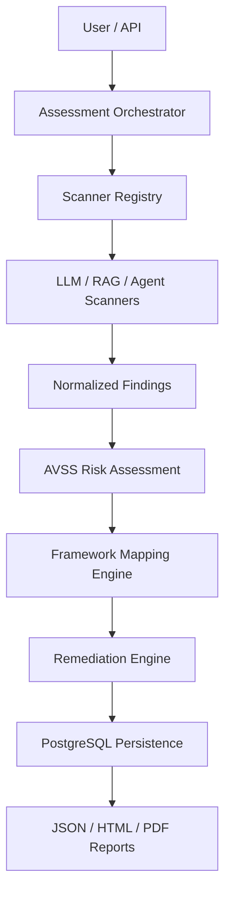

# AegisAI — Enterprise AI Application Security Assessment Platform

AegisAI is an independent, modular AI application security assessment and red-teaming platform designed to evaluate **Large Language Model (LLM)** endpoints, **Retrieval-Augmented Generation (RAG)** pipelines, and **Autonomous AI Agents** using deterministic probes, hybrid evaluators, transparent risk scoring, and evidence-driven security framework mapping.

> **Disclaimer:** AegisAI is an independent security assessment project. It does **not** provide formal security certification, legal compliance attestation, or a guarantee of complete vulnerability detection.

---

## 1. Project Overview

Modern AI applications introduce attack surfaces that traditional SAST, DAST, and web application firewalls do not understand—such as instruction hierarchy overrides, indirect prompt injection through retrieved documents, cross-tenant vector store leakage, and unauthorized agent tool invocation.

AegisAI addresses this gap with a security-first **modular monolith** backend built in Python/FastAPI, paired with a PostgreSQL persistence layer and an authoritative JSON knowledge base. Every security check produces normalized, evidence-backed results that flow through an **AVSS v1.0** risk scoring engine, an immutable **Framework Mapping Engine**, an **8-part Remediation Engine**, and a **CSP-hardened Report Generator**.

---

## 2. Problem Statement

Conventional application security scanners evaluate HTTP syntax and deterministic code sinks, but fail when:
- **Untrusted data enters model context** (e.g., poisoned RAG chunks or web documents hijacking model behavior).
- **Multi-tenant vector retrieval lacks metadata isolation**, leaking Tenant A's proprietary context to Tenant B.
- **Autonomous agents expose privileged tools** without human-in-the-loop approval gates or strict parameter validation.
- **Compliance teams need traceable evidence** linking a technical finding to authoritative AI security standards (OWASP LLM Top 10, OWASP Agentic Top 10, OWASP AISVS, NIST AI RMF / 600-1, MITRE ATLAS, and ISO/IEC 42001 & 23894) without relying on opaque "black-box" risk scores.

---

## 3. Core Capabilities

- **Multi-Architecture Assessment Engine:** Supports `LLM_ONLY`, `RAG`, `AGENT`, `HYBRID`, and `CONFIG_ONLY` target profiles via pluggable adapters (`OpenAICompatibleAdapter`, `GenericRestAdapter`, `RAGHarnessAdapter`, and `BuiltInTargetSimulator`).
- **13 Registered Security Test Plugins:** Covers LLM Security (Module A), RAG Security (Module B), and Agentic AI Security (Module C), plus static configuration auditing (`CONFIG`).
- **Strict Security Boundaries:** Pre-connect DNS resolution and IP pinning SSRF guard (`SafeTargetClient`), AES-GCM envelope encryption for target credentials, mandatory scope attestation before scan execution, and unified recursive secret/PII redaction across logs, audit trails, and evidence.
- **AVSS v1.0 Risk Assessment:** Transparent, deterministic scoring formula separating technical severity from evidentiary confidence and confirmation status.
- **Immutable Framework Knowledge Base:** 63 controls across 6 authoritative framework bundles with version-locked historical snapshots.
- **Actionable Remediation Intelligence:** Dynamically tailored 8-section engineering remediation guides with secure Python/FastAPI code patterns and verification procedures.
- **Enterprise Reporting:** Structured JSON, CSP-hardened self-contained HTML (`script-src 'none'`), and pure-Python PDF 1.4 exports.

---

## 4. Architecture Overview

AegisAI is structured as a modular monolith with strict internal domain boundaries:



### Key Architectural Principles
1. **Contract-Driven Execution:** All scanners implement `BaseSecurityTest` and emit `NormalizedTestResult` objects containing `TechnicalEvidenceItem` records.
2. **Auditability:** `test_execution_results` records every check executed (`PASS`, `FAIL`, `ERROR`, `NOT_APPLICABLE`, `NEEDS_REVIEW`), while `findings` stores actionable vulnerabilities and review items.
3. **Atomic Concurrency & Failure Recovery:** The orchestrator claims queued assessments via an atomic `QUEUED -> PROFILING` update and recovers interrupted runs safely so assessments do not remain stuck in `EXECUTING_TESTS`.
4. **Defense-in-Depth for Outbound Probes:** Target adapters route through `SafeTargetClient`, which validates target URLs against the attested `allowed_hosts` scope, blocks private/loopback/metadata IP ranges (unless explicitly configured for isolated local testing), and pins connections to the validated IP address to prevent DNS rebinding (TOCTOU).

---

## 5. Scanner Architecture

Scanners are discovered through a decorator-based `SecurityTestRegistry` (`backend/app/engine/registry.py`) and executed by the `AssessmentOrchestrator` (`backend/app/engine/orchestrator.py`):

- **Target Profiling & Static Analysis:** Before active probes run, `TargetProfiler` verifies connectivity and captures baseline guardrail signatures, while `ConfigAnalyzer` inspects `architecture_manifest`, `rag_harness_config`, and `agent_harness_config`.
- **Hybrid Evaluation:** Scanners combine deterministic evaluators (`DeterministicCanaryMatcher`, `OutputSinkASTDetector`, `SystemPromptSimilarityEvaluator`) with semantic analysis (`SemanticJudge`).
- **Evidence Sanitization:** All captured HTTP requests, responses, headers, and matched indicators pass through recursive secret/PII redaction (`evidence.py`) prior to database persistence or report generation.
- **`CONFIG_ONLY` Isolation:** Targets configured in `CONFIG_ONLY` mode skip DNS resolution and active network probes, running only static configuration rule checks.

---

## 6. Supported Assessment Categories

### Module A — LLM Security (6 Plugins)
| Test ID | Name | Focus Area |
| :--- | :--- | :--- |
| `LLM-PI-001` | Direct Prompt Injection | Instruction hierarchy override and system constraint bypass |
| `LLM-PI-002` | Indirect Prompt Injection | Untrusted context ingestion hijacking model output |
| `LLM-SPE-001` | System Prompt & Context Exposure | System prompt leakage and static secret/prompt hygiene |
| `LLM-SID-001` | Sensitive Information Disclosure | Secret, API key, and PII leakage in model responses |
| `LLM-IOH-001` | Improper Output Handling | XSS, HTML/script sinks, and Markdown exfiltration beacons |
| `LLM-CFG-001` | Unbounded Consumption & Config Audit | Token/rate limits, timeout bounds, and model configuration checks |

### Module B — RAG Security (4 Plugins)
| Test ID | Name | Focus Area |
| :--- | :--- | :--- |
| `RAG-AUTH-001` | Cross-Tenant Retrieval Authorization Bypass | Dual-tenant canary verification for cross-user document leakage |
| `RAG-IPI-001` | Indirect Prompt Injection via Poisoned Chunk | Adversarial instructions embedded in retrieved vector chunks |
| `RAG-META-001` | Metadata Filter Manipulation | Filter bypass and tenant context isolation failures |
| `RAG-ARCH-001` | RAG Pipeline & Vector Store Configuration Audit | Static audit of retrieval ACLs, top-k bounds, and chunk sanitization |

### Module C — Agentic AI Security (3 Plugins)
| Test ID | Name | Focus Area |
| :--- | :--- | :--- |
| `AGT-TOOL-001` | Unauthorized Tool Invocation & Parameter Manipulation | Dry-run inspection of tool calls and argument injection |
| `AGT-GH-001` | Agent Goal Hijacking via Indirect Context | Task/goal redirection via untrusted tool or context payloads |
| `AGT-PERM-001` | Excessive Agency & Missing Approval Gate Audit | Static audit of tool permissions, schemas, and human-in-the-loop gates |

---

## 7. AVSS Risk Assessment Engine

The `RiskAssessmentEngine` (`backend/app/engine/risk_engine.py`) computes transparent **AVSS v1.0** (AI Vulnerability Scoring System) scores on a `0.0 – 10.0` scale:

$$\text{Raw Score} = \min\left(10.0,\ (0.40 \cdot I + 0.30 \cdot E + 0.20 \cdot B + 0.10 \cdot X) \cdot C\right)$$

Where:
- **I**: Technical Impact (`0–10`)
- **E**: Exploitability (`0–10`)
- **B**: Blast Radius (`0–10`)
- **X**: Exposure (`0–10`)
- **C**: Compensating Control Multiplier (`0.5–1.0`)

Each finding receives an AVSS vector string (e.g., `AVSS:1.0/I:9.0/E:8.5/B:8.0/X:8.0/C:1.0/CONF:HIGH`), a canonical severity (`CRITICAL`, `HIGH`, `MEDIUM`, `LOW`, `INFORMATIONAL`), an independent evidentiary confidence (`HIGH`, `MEDIUM`, `LOW`), a confirmation status (`CONFIRMED` vs. `UNCONFIRMED_NEEDS_REVIEW`), and a plain-English severity rationale. Low confidence never artificially lowers technical severity.

---

## 8. Framework Mapping Engine

The `FrameworkMappingEngine` (`backend/app/engine/framework_mapper.py`) maps findings to **63 controls** across **6 authoritative knowledge base bundles** in `backend/app/knowledge_base/`:

1. **OWASP Top 10 for LLM Applications (2026)** (`LLM01:2026` – `LLM10:2026`)
2. **OWASP Top 10 for Agentic Applications (2026)** (`ASI01` – `ASI10`)
3. **OWASP AI Security Verification Standard (AISVS v1.0)** (`C1` – `C12`)
4. **NIST AI RMF 1.0 & NIST AI 600-1 Generative AI Profile** (`GOVERN`, `MAP`, `MEASURE`, `MANAGE`)
5. **MITRE ATLAS** (`AML.T0051`, `AML.T0054`, `AML.T0056`, `AML.T0071`, `AML.T0048`, etc.)
6. **ISO/IEC 42001:2023 & ISO/IEC 23894:2023**

Mappings are **evidence-driven** using conditional rules over detector types, matched indicators, static config rules, and target components, classifying each relationship as `DIRECT`, `RELATED`, or `SUPPORTING`. Seeded framework versions are immutable (`ImmutableFrameworkVersionError`), and assessments preserve historical `framework_kb_snapshot` metadata.

---

## 9. Remediation Intelligence

The `RemediationEngine` (`backend/app/engine/remediation_engine.py`) combines validated playbooks (`remediation_playbooks.json`) with finding-specific evidence to generate an **8-part technical remediation guide** for each vulnerability:

1. **Summary** — Concise technical remediation objective
2. **Root Cause** — Component- and evidence-specific root cause analysis
3. **Priority** — Action priority aligned with AVSS severity
4. **Preventive Controls** — Concrete engineering controls to block exploitation
5. **Detective Controls** — Telemetry, logging, and alerting controls
6. **Implementation Steps** — Step-by-step engineering tasks
7. **Secure Code Example** — Reference Python/FastAPI/Schema implementation pattern
8. **Verification Procedures** — Deterministic re-testing steps to confirm remediation

---

## 10. Reporting Capabilities

The `ReportGenerator` (`backend/app/engine/report_generator.py`) produces three export formats persisted via `ReportArtifact`:
- **JSON:** Full machine-readable assessment payload with AVSS vectors, immutable framework mappings, redacted evidence, and remediation guides.
- **HTML:** Self-contained, print-ready enterprise report hardened with strict output escaping (`html.escape(..., quote=True)`), `http(s)`-only link validation, and a locked-down Content-Security-Policy (`script-src 'none'`, `object-src 'none'`, `frame-ancestors 'none'`).
- **PDF:** Pure-Python PDF 1.4 export generated directly from the sanitized report payload.

All reports include explicit non-certification disclaimers and preserve historical framework snapshots.

---

## 11. Technology Stack

| Layer | Technologies |
| :--- | :--- |
| **Backend API** | Python 3.11+, FastAPI, Pydantic v2, pydantic-settings, Uvicorn |
| **Database & Migrations** | PostgreSQL 16 (production/Docker), SQLite (local dev/test), SQLAlchemy 2.0, Alembic |
| **Security & Crypto** | `cryptography` (AES-GCM envelope encryption), `PyJWT`, `bcrypt`, `httpx` |
| **Testing & Linting** | `pytest`, `pytest-asyncio`, `ruff` |
| **Frontend (Foundation)** | Next.js 15, React 19, TypeScript, Tailwind CSS |
| **Infrastructure** | Docker Compose (PostgreSQL 16, Redis 7, Backend, Frontend) |

---

## 12. Project Structure

```text
AegisAI/
├── .env.example                    # Environment configuration template (placeholders only)
├── .gitignore
├── docker-compose.yml              # Multi-service local/container stack
├── README.md
├── ARCHITECTURE.md                 # System architecture & AVSS v1.0 specification
├── DATABASE_SCHEMA.md              # Relational + JSONB schema design
├── PROJECT_PLAN.md                 # Scope, feasibility & MVP criteria
├── ROADMAP.md                      # 8-phase engineering roadmap
├── SECURITY_DESIGN.md              # SSRF, crypto, RBAC & redaction design
├── THREAT_MODEL.md                 # STRIDE threat model of AegisAI
├── IMPROVEMENT_BACKLOG.md          # Hardening register & Stage 2/post-MVP backlog
├── TECHNICAL_ARCHITECTURE_GUIDE.md # Deep-dive engineering guide
├── backend/
│   ├── Dockerfile
│   ├── pyproject.toml
│   ├── alembic.ini
│   ├── alembic/versions/           # Database migrations (0001, 0002)
│   ├── app/
│   │   ├── api/v1/                 # Auth, Targets, Assessments, Findings, Frameworks, Reports
│   │   ├── core/                   # Config, Security/JWT, Crypto, SSRF Guard, Audit, Logging
│   │   ├── db/                     # SQLAlchemy Base & Session management
│   │   ├── engine/                 # Orchestrator, Registry, Profiler, Evidence, Risk, Mapper, Remediation, Reports
│   │   │   ├── adapters/           # OpenAI-compat, Generic REST, RAG Harness, Built-in Simulator
│   │   │   ├── evaluators/         # Deterministic & Semantic evaluators
│   │   │   └── scanners/           # LLM, RAG, and Agent scanner plugins
│   │   ├── knowledge_base/         # 6 authoritative framework JSONs + remediation playbooks
│   │   ├── models/                 # SQLAlchemy ORM models
│   │   └── schemas/                # Pydantic request/response schemas
│   └── tests/                      # 76 automated backend tests
└── frontend/
    ├── Dockerfile
    ├── package.json
    └── src/                        # Next.js 15 foundation UI & API client
```

---

## 13. Installation Instructions

### Prerequisites
- Python 3.11+
- Node.js 20+ (optional, for frontend)
- Docker & Docker Compose (optional, for PostgreSQL 16 + Redis 7 stack)

### Local Backend Setup
```bash
git clone https://github.com/<your-username>/AegisAI.git
cd AegisAI

# Create and activate a virtual environment
python -m venv .venv
# Linux/macOS:
source .venv/bin/activate
# Windows (PowerShell):
.\.venv\Scripts\Activate.ps1

# Install backend dependencies (including dev tools: pytest, ruff)
pip install -e "./backend[dev]"
```

---

## 14. Configuration Instructions

Copy `.env.example` to `.env` and customize values for your environment:

```bash
cp .env.example .env
```

Key environment variables:
- `AEGIS_ENV`: `development`, `staging`, `production`, or `test`. (In `production` and `staging`, `AEGIS_JWT_SECRET_KEY` and `AEGIS_MASTER_ENCRYPTION_KEY` must be overridden with non-default secrets of at least 32 characters.)
- `DATABASE_URL`: PostgreSQL 16 connection string for production/Docker, or `sqlite:///./aegis_local.db` for local development.
- `AEGIS_ALLOW_ISOLATED_LOCAL_TARGETS`: Keep `false` in production; set `true` only when testing isolated local simulators listed in `AEGIS_ALLOWED_LOCAL_HOSTS`.
- `AEGIS_DEFAULT_MAX_RPS`, `AEGIS_MAX_REQUESTS_PER_ASSESSMENT`, `AEGIS_MAX_RESPONSE_BYTES`: Outbound probe rate-limit and payload safety bounds.

---

## 15. Running the Application

### Option A: Local Backend (Uvicorn + SQLite)
```bash
cd backend
alembic -c alembic.ini upgrade head
uvicorn app.main:app --reload --host 0.0.0.0 --port 8000
```
API documentation is available at `http://localhost:8000/docs` (in non-production environments) and health check at `http://localhost:8000/health`.

### Option B: Full Stack via Docker Compose
```bash
docker compose up --build
```
This starts PostgreSQL 16 (`5432`), Redis 7 (`6379`), the FastAPI backend (`8000`), and the Next.js frontend (`3000`).

---

## 16. Running Tests

From the `backend/` directory:

```bash
# Run the complete backend test suite (76 tests)
python -m pytest -v

# Run Ruff linter
python -m ruff check .

# Verify Alembic migrations
python -m alembic -c alembic.ini current
```

---

## 17. Security Considerations

AegisAI is designed with security-first controls documented in [SECURITY_DESIGN.md](./SECURITY_DESIGN.md) and [THREAT_MODEL.md](./THREAT_MODEL.md):
- **Scope Attestation Required:** Assessments cannot start without explicit tenant scope attestation (`ASSESSMENT_SCOPE_ATTESTED` audit event).
- **SSRF & DNS Rebinding Mitigation:** `SafeTargetClient` resolves DNS prior to connection, rejects private/loopback/link-local/CGNAT/metadata IPs, and pins outbound requests to the validated IP while preserving `Host` and TLS SNI.
- **Tenant Isolation & RBAC:** Multi-tenant `organization_id` scoping with role-based access control (`ADMIN`, `ANALYST`, `VIEWER`) and per-tenant AES-GCM credential encryption.
- **Secret & PII Redaction:** API keys, bearer tokens, cookies, private keys, and sensitive dictionary fields are redacted before persistence in logs, audit events, and technical evidence.
- **No Unattended Production Defaults:** Production and staging startup validators reject default, missing, or short (`< 32` chars) JWT and master encryption keys.

---

## 18. Current Development Status

- **Phases 1 – 6 + Stage 1 Backend Security & Contract Hardening:** **Completed** (76 backend tests passing, Ruff clean, Alembic migrations `0001` and `0002` verified).
- **Phase 7 (Enterprise SaaS Frontend Integration):** **In Progress** — Next.js 15 foundation, authentication client, and landing/login views are present; full dashboard, assessment wizard, finding detail, and report UI views are planned per [ROADMAP.md](./ROADMAP.md).
- **Phase 8 (End-to-End Validation & Stage 2 Refinements):** **Planned** — Tracked in [IMPROVEMENT_BACKLOG.md](./IMPROVEMENT_BACKLOG.md).

---

## 19. Future Improvements

Tracked in [IMPROVEMENT_BACKLOG.md](./IMPROVEMENT_BACKLOG.md):
- Multi-page pagination and line wrapping in PDF report generation (`STG2-004`).
- Configurable untrusted context role framing (`user`/`tool`) in `OpenAICompatibleAdapter` (`STG2-001` / `ENH-005`).
- Out-of-band (OOB) loopback canary receiver for asynchronous agent tool calls (`ENH-001`).
- Automated ephemeral canary document seeding hooks for RAG pipelines (`ENH-002`).
- Static Python/TypeScript AST source-code scanner (`ENH-003`) and multi-modal indirect injection probes (`ENH-004`).
- Completion of Phase 7 Enterprise Frontend UI and Phase 8 End-to-End Validation.

---

## 20. Disclaimer

AegisAI is an independent security assessment and engineering portfolio project. Findings, AVSS risk scores, framework mappings, and remediation guides are provided for informational and defensive engineering purposes only. Running AegisAI does **not** constitute formal security certification, regulatory compliance approval, or a guarantee that all vulnerabilities in an AI system have been identified. Only assess AI systems for which you hold explicit authorization.
