# AegisAI — Phased Engineering Roadmap

**Document Status:** Phase 5 Complete — Modules A, B & C Implemented & Verified (13 Security Test Suites)  
**Methodology:** Incremental, Test-Driven, Security-First Delivery  

---

## 1. Phased Execution Overview

AegisAI is engineered across 8 disciplined phases. No phase is marked complete until its automated verification suite passes and regressions are zero.

```mermaid
flowchart LR
    P1["Phase 1: Research & Architecture"] --> P2["Phase 2: Project Foundation & Security Core"]
    P2 --> P3["Phase 3: Modular Assessment Engine"]
    P3 --> P4["Phase 4: Module A — LLM Scanner"]
    P4 --> P5["Phase 5: Modules B & C — RAG & Agent Scanners"]
    P5 --> P6["Phase 6: Risk, Framework KB & Remediation"]
    P6 --> P7["Phase 7: Enterprise Frontend & Reporting UI"]
    P7 --> P8["Phase 8: E2E Validation & Hardening"]
```

---

## 2. Detailed Phase Breakdown

### Phase 1: Research, Feasibility & Architecture (Current Phase)
- **Deliverables:**
  - `PROJECT_PLAN.md`: Feasibility matrix, assumption challenges, MVP scope.
  - `ARCHITECTURE.md`: Modular monolith topology, plugin contracts, AVSS v1.0 risk formula.
  - `SECURITY_DESIGN.md`: SSRF guard, envelope encryption, scope attestation, evidence redaction.
  - `DATABASE_SCHEMA.md`: Relational + JSONB schema and authoritative framework table design.
  - `ROADMAP.md`: Phased execution plan.
  - `THREAT_MODEL.md`: STRIDE threat model of AegisAI itself.
- **Gate:** Product Owner review before writing application implementation code.

### Phase 2: Project Foundation & Platform Security Core
- **Deliverables:**
  - Repository scaffolding (`backend/`, `frontend/`, `docker-compose.yml`, `.env.example`).
  - FastAPI application with structured logging, global exception handlers, and CORS configuration.
  - SQLAlchemy 2.0 models & Alembic migration initialization.
  - Security primitives:
    - `ssrf_guard.py`: Pre-connect DNS resolution, private/loopback/metadata IP blocking.
    - `crypto.py`: Authenticated encryption for target API credentials.
    - `security.py`: JWT authentication, password hashing, and multi-tenant RBAC dependencies.
    - `audit.py`: Immutable audit logging service.
- **Verification:** Unit and integration tests for Auth, RBAC tenant isolation, credential encryption round-trip, and SSRF guard blocking `127.0.0.1`, `10.x.x.x`, and `169.254.169.254`.

### Phase 3: Assessment Engine Core & Target Adapters
- **Deliverables:**
  - `contracts.py`: `BaseSecurityTest`, `TestContext`, `NormalizedTestResult`, `TechnicalEvidenceItem`.
  - `registry.py`: Decorator-based plugin registration (`@register_security_test`) and filtering by module/architecture.
  - `profiler.py` & `config_analyzer.py`: Connectivity profiler and static manifest analyzer.
  - `evidence.py`: Automatic header and secret/PII redaction pipeline.
  - `adapters/`: `OpenAICompatibleAdapter`, `GenericRestAdapter`, `RAGHarnessAdapter`, and `BuiltInTargetSimulator` (providing reproducible vulnerable & hardened endpoints for automated testing).
  - `orchestrator.py`: State machine managing assessment execution, rate limits, timeouts, and progress updates.
- **Verification:** Orchestrator lifecycle tests verifying `PASS`, `FAIL`, `ERROR` (on timeout/500), `NOT_APPLICABLE`, and `NEEDS_REVIEW` transitions.

### Phase 4: Module A — LLM Security Assessment
- **Deliverables:**
  - Implementation of 6 multi-probe LLM security test plugins:
    1. `LLM-PI-001`: Direct Prompt Injection & Instruction Hierarchy Override.
    2. `LLM-PI-002`: Indirect Prompt Injection via Untrusted Context Ingestion.
    3. `LLM-SPE-001`: System Prompt & Hidden Context Exposure (`LLM08:2026`).
    4. `LLM-SID-001`: Sensitive Information, Secret & PII Disclosure (`LLM02:2026`).
    5. `LLM-IOH-001`: Improper Output Handling — XSS, Markdown Exfiltration & Sink Payloads (`LLM10:2026`).
    6. `LLM-CFG-001`: Unbounded Consumption & Model Configuration Weakness Analysis (`LLM06:2026`).
  - Hybrid evaluators (`DeterministicCanaryMatcher`, `OutputSinkASTDetector`, `SystemPromptSimilarityEvaluator`).
- **Verification:** Automated test suite proving each scanner detects vulnerable behavior on a vulnerable target profile and records `PASS` on a hardened target profile.

### Phase 5: Module B (RAG Security) & Module C (Agent Security)
- **Deliverables:**
  - **Module B (RAG Security Scanner):**
    1. `RAG-AUTH-001`: Cross-User / Cross-Tenant Retrieval Authorization Bypass (using dual-tenant canary verification).
    2. `RAG-IPI-001`: Indirect Prompt Injection via Poisoned Retrieved Chunk (`AML.T0071`).
    3. `RAG-META-001`: Metadata Filter Manipulation & Context Isolation Failure.
    4. `RAG-ARCH-001`: RAG Pipeline & Vector Store Configuration Audit (`LLM09:2026`, `AISVS C8`).
  - **Module C (AI Agent Security Scanner):**
    1. `AGT-TOOL-001`: Unauthorized Tool Invocation & Parameter Manipulation (`ASI02`).
    2. `AGT-GH-001`: Agent Goal Hijacking via Indirect Context (`ASI01`).
    3. `AGT-PERM-001`: Excessive Agency, Missing Human Approval Gate & Tool Schema Audit (`LLM03:2026`, `ASI03`, `ASI09`, `AISVS C9/C10`).
- **Verification:** Deterministic component attribution and vulnerability detection verified against multi-tenant RAG and Agent harnesses.

### Phase 6: Framework Knowledge Base, Risk Engine & Intelligent Remediation (COMPLETED)
- **Deliverables:**
  - Authoritative JSON knowledge base & database seed covering:
    - **OWASP Top 10 for LLM Applications (2026)** (`LLM01:2026` – `LLM10:2026`)
    - **OWASP Top 10 for Agentic Applications (2026)** (`ASI01` – `ASI10`)
    - **OWASP AI Security Verification Standard (AISVS v1.0)** (`C1` – `C12`)
    - **NIST AI RMF 1.0 & NIST AI 600-1 Generative AI Profile** (`GOVERN`, `MAP`, `MEASURE`, `MANAGE`)
    - **MITRE ATLAS** (`AML.T0051`, `AML.T0051.000`, `AML.T0051.001`, `AML.T0054`, `AML.T0056`, `AML.T0071`, `AML.T0048`)
    - **ISO/IEC 42001:2023 (Annex A.2–A.10) & ISO/IEC 23894:2023**
  - Immutable framework versioning and historical `framework_kb_snapshot` preservation (`FrameworkMappingEngine`, `ImmutableFrameworkVersionError`).
  - Evidence-driven conditional framework mappings (`DIRECT`, `RELATED`, `SUPPORTING`).
  - `RiskAssessmentEngine` computing AVSS v1.0 scores, vectors, orthogonal severity/confidence/confirmation status, and plain-English rationales.
  - `RemediationEngine` producing 8-section technical remediation guides with secure code examples and verification procedures.
  - `ReportGenerator` generating structured JSON and self-contained, CSP-hardened, print-ready Enterprise HTML/PDF reports with non-certification disclaimers.
- **Verification:** Schema validation of all 6 framework bundles (60 controls, zero invented IDs), Alembic migration `0002`, and end-to-end API/report/tenancy tests (all 68 backend tests passing).

### Phase 7: Enterprise SaaS Frontend Integration
- **Deliverables:**
  - Next.js + TypeScript + Tailwind CSS application featuring:
    - **Security Posture Dashboard:** KPI cards, severity distribution chart, framework compliance summary, recent assessments table.
    - **New Assessment Wizard:** Target configuration, architecture manifest builder, module selector, and explicit Scope & Authorization Attestation step.
    - **Assessment Detail & Results View:** Real-time progress indicator, posture grade, filterable findings table, test execution matrix (`PASS`, `FAIL`, `ERROR`, `NEEDS_REVIEW`), and component attribution tags.
    - **Dedicated Vulnerability Detail View:** AVSS risk breakdown, redacted HTTP request/response evidence viewer, Direct vs. Conceptual framework badges with official links, and 8-part remediation guide with syntax-highlighted secure code patterns.
    - **Framework Knowledge Base Explorer & Downloadable Report View.**
- **Verification:** TypeScript type-checking (`tsc --noEmit`), production build check, and full API integration.

### Phase 8: End-to-End Validation & Security Hardening
- **Deliverables:**
  - Full regression test execution (unit, integration, security boundary tests).
  - Verification of all 10 MVP Success Criteria.
